<p align="center">
  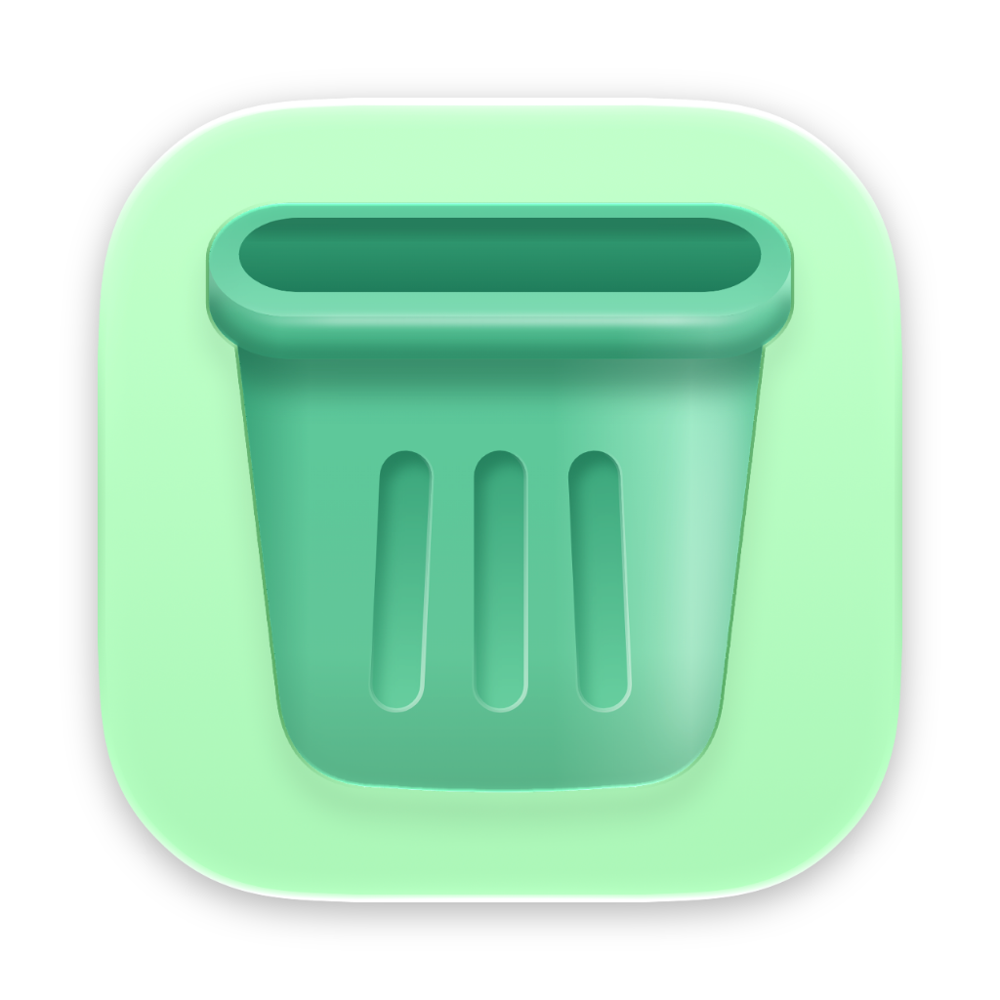
</p>

<h1 align="center">Tossy</h1>

<p align="center">
  See what fills your disk, and clean only what is safe to clean.<br>
  <a href="https://github.com/21stware/tossy/releases/latest">Download for macOS, Windows and Linux</a>
</p>

Tossy is a disk cleanup analyser. It shows what fills your disk as a sunburst you can drill into, gives everything a safety verdict, and cleans only what is safe to clean in one click. Anything it removes can be put back until you empty its trash.

It ships as a native desktop app (built with [MyGo](https://github.com/egoist/mygo)) and a command-line tool, both on the same Go engine. It runs on macOS, Linux and Windows.

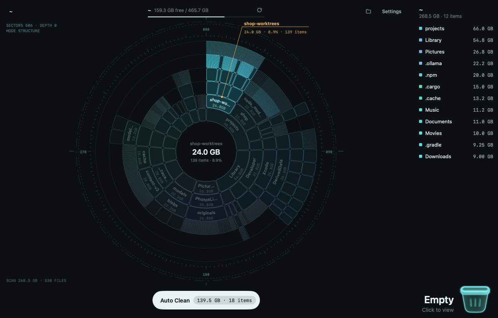

## Download

Get the latest build from [Releases](https://github.com/21stware/tossy/releases/latest).

**macOS** (12 or later, Apple silicon and Intel): open `tossy-<version>.dmg` and drag Tossy into Applications. The app is signed with a Developer ID and notarized by Apple, so it opens like any other.

**Windows** (10 and 11, x64 and ARM64): run `tossy-setup-<version>-amd64.exe` (`arm64` on ARM). It installs Tossy for your user, with no administrator rights, and adds it to the Start menu. The installer is not code-signed yet, so SmartScreen may ask you to confirm: More info → Run anyway. Or install from PowerShell with `irm https://github.com/21stware/tossy/releases/latest/download/install.ps1 | iex`.

**Linux** (x86-64 and ARM64; needs GTK 3):

| Distribution | File | Install |
| --- | --- | --- |
| Debian, Ubuntu | `tossy_<version>_amd64.deb` | `sudo apt install ./tossy_<version>_amd64.deb` |
| Fedora, RHEL | `tossy-<version>-1.x86_64.rpm` | `sudo dnf install ./tossy-<version>-1.x86_64.rpm` |
| Any (Arch too), per user | `tossy-<version>-linux-amd64.tar.gz` | `sh install.sh tossy-<version>-linux-amd64.tar.gz` |

ARM64 files carry `arm64` / `aarch64` in place of `amd64` / `x86_64`. The command-line tool is attached as `tossy-cli-<version>-<os>-<arch>.tar.gz` (`.zip` for Windows). `SHA256SUMS` lists the checksums of every file.

**Updates.** The app updates itself: it checks for a new release once a day, shows what is new and offers to install it, and downloads only what changed since your version. Check by hand with Tossy → Check for Updates… on macOS, or in Settings → Updates, where the background checks can also be turned off or left to install on their own. Every update is signed, and the app refuses one that is not signed with Tossy's key. An app installed from the `.deb` or `.rpm` is updated by installing the newer package instead; the one `install.sh` puts in `~/.local` updates itself.

## Features

### See what fills the disk

- **Fast parallel scan** that builds a compact tree able to hold millions of entries. On macOS it reads whole batches of directory entries per syscall (`getattrlistbulk`), on Linux it uses `fstatat`, and on Windows it takes sizes straight from `FindFirstFile`. Pseudo filesystems are skipped, and other volumes are left alone unless you allow it.
- **Sunburst chart.** Click a sector to drill in; use the centre, the breadcrumbs or Backspace to go back up. Sectors morph when things are removed or restored. While scanning, the chart is a radar sweep with live counters.
- **List and detail.** The right-hand panel lists the folder in focus by size; selecting a file slides in its detail with the verdict and the reason for it.
- **Disk line** at the top shows how full the volume is.

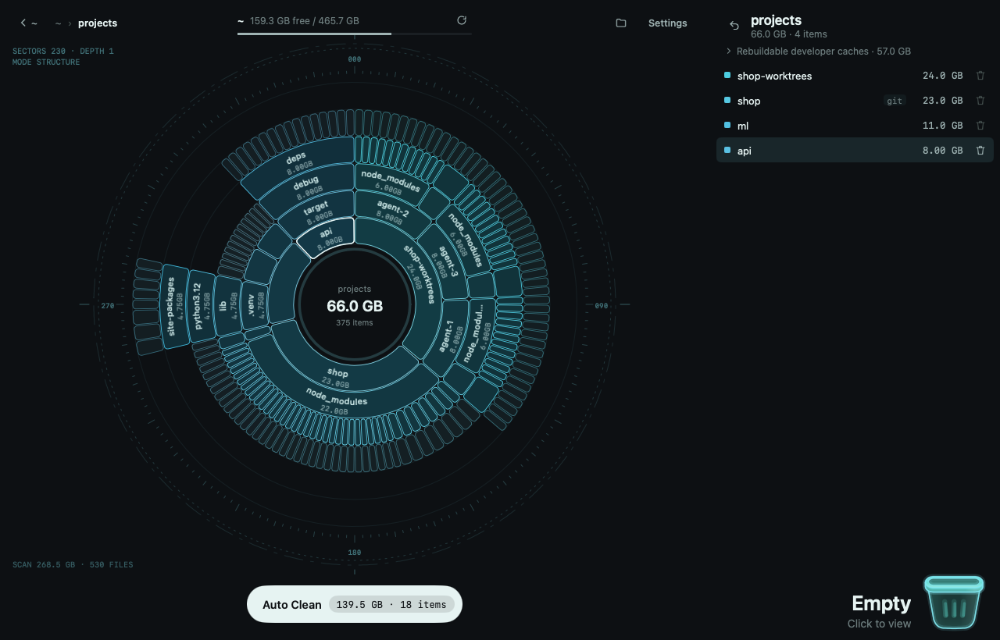

### Safety verdicts

About 90 built-in rules give every item one of four levels. An item without a rule of its own inherits its parent's verdict.

| Level | Meaning | Examples |
| --- | --- | --- |
| Safe | Rebuilt or re-downloaded on demand | App caches, `node_modules`, `__pycache__`, npm / pnpm / Cargo / Go / Maven / Gradle caches, Xcode DerivedData, Rust `target`, Homebrew cache |
| Review | Probably fine, but you should confirm | Docker and VM disks, iOS simulators, local models (Ollama, LM Studio, Hugging Face), Python virtualenvs, build output, Downloads, AI coding-assistant sessions |
| Personal | Your own data | Documents, Desktop, Photos, Mail, `.ssh`, `.gnupg`, `.git` |
| Protected | The OS needs it; Tossy never deletes it | `/System`, `/usr`, `C:\Windows`, `WinSxS` |

Generic names such as `dist`, `build`, `target` or `vendor` only match inside a real project, recognised by marker files like `package.json`, `Cargo.toml` or `go.mod`.

Personal folders are recognised by name, and some of those names are everyday words. A folder called `desktop`, `documents`, `pictures`, `music`, `mail` or `messages` that is itself a project (it holds a `.git` or a marker file) is judged as a project, so the `node_modules` of a monorepo's `desktop` app can be cleaned like any other. The folders of your home directory (`~/Documents`, `~/Desktop`, `~/Pictures`, `~/Music`, `~/Library/Mail`…) are personal whatever they hold, and so is everything inside them.

### Developer view

The switch beside the Auto Clean button (or ⌘D) turns the same scan into a developer's view: only what building software leaves behind, wherever it sits on the disk, grouped by kind instead of by folder.

| Kind | What it holds |
| --- | --- |
| Dependencies | `node_modules`, Pods, Composer and Go `vendor`, Python virtualenvs, `.terraform` |
| Build output | Rust and Maven `target`, Gradle and CMake `build`, `.next`, `dist`, `__pycache__`, Xcode archives |
| Build cache | Xcode DerivedData, `go-build`, ccache / sccache, `.turbo`, `.pytest_cache`, coverage reports |
| Package cache | npm, pnpm, Yarn, Cargo, Go modules, Maven, Gradle, NuGet, pub, Conda and Homebrew downloads |
| Emulators & devices | Android emulator images (AVD), iOS simulators, device support files |
| Containers & VMs | Docker, Colima, Lima and OrbStack disks |
| Local models | Ollama, LM Studio, Hugging Face and PyTorch weights |
| App cache | What apps keep in `~/Library/Caches` and `~/.cache`, Electron and browser caches |

- **The first ring is the kinds, the second the items**: a project's `node_modules`, a tool's cache, an emulator. An item is named with the folder it sits in (`shop/node_modules`), and from there on you drill into the real folders.
- **Everything else works as on the disk.** Verdicts, deleting by hand, dragging onto the bin and undo behave the same, and both views stay in step: what you delete in one is gone from the other.
- **Auto Clean takes only developer content here**, and still only what is safe. A kind in focus has its own button that cleans the safe items of that kind. Emulators, virtual machine disks, models and virtualenvs are listed but left for you to delete one by one.
- The view you were in is remembered for the next launch.

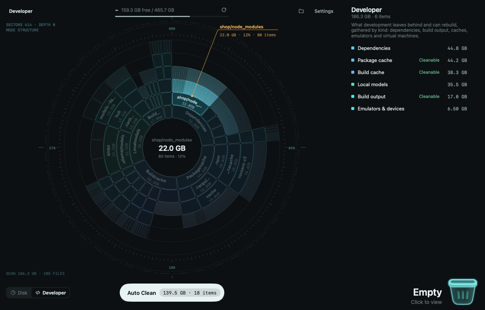

### Developer folders

- **Git checkouts are judged as a whole.** Before you delete a repository or worktree, Tossy asks git about uncommitted changes, untracked files and commits that exist only on this machine, and tells you what would be lost.
- **Worktrees at a glance.** A repository lists every worktree that shares its object store; AI coding agents tend to leave many behind.
- **Build caches per project.** A project folder lists the dependency and build caches inside it, with one button to clean them.

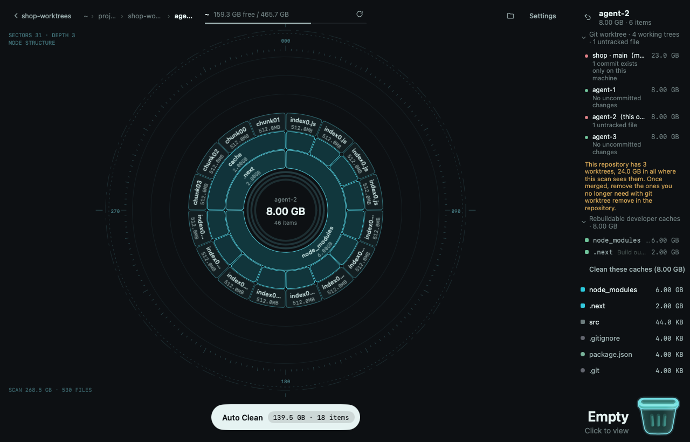

### Cleaning

- **Auto Clean** sweeps the whole scan using the rules and your learned habits, shows what it finds as it goes, and then throws the plan into the trash. It only takes things that are regenerated on demand, or that match something you have deleted by hand before.
- **In-use protection.** Items written in the last few minutes (10 by default) and the caches of apps that are running are skipped, so a clean never pulls caches out from under a running program.
- **Delete by hand** with the row's bin button, the context menu, the keyboard (Delete / ⌘⌫), or by dragging a sector onto the bin. Protected items shake and say why. Personal data asks first. Everything else goes at once, with an undo.
- **Learns your habits.** Each manual deletion is generalised to "parent folder + shape" (a sub-folder, a file extension, or "older than two months"). Once a shape has been seen often enough it becomes a habit, and Auto Clean takes the same kind of item next time and says why. Restoring an item a habit picked counts double against it. You can review, forget or turn off habits in Settings.

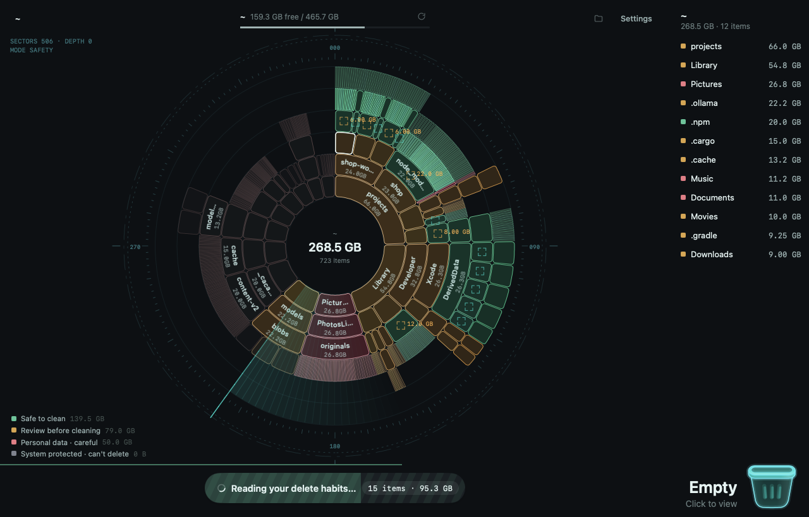

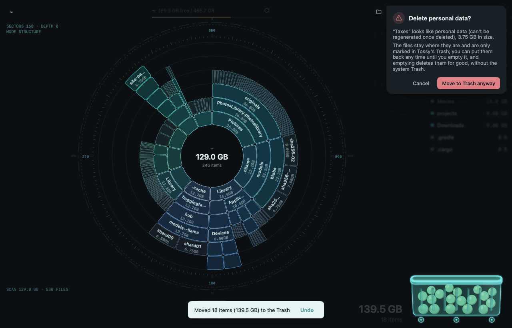

### The trash

- **A mark, not a move.** Putting something in Tossy's trash only records a mark in a journal. The file stays where it is, and the system trash is never touched. Restoring drops the mark; emptying deletes exactly the marked paths, in place, for good.
- **Trash view.** The bin grows with what is in it, from a desk basket through the app icon's bin, a pedal bin and a wheelie bin to a skip and a roll-off container, made the way the style draws its chart: cyan glass on the HUD, a cobalt plate on the mech, white or phosphor linework on the blueprint and the terminal, off-white hardware with an orange rim on the industrial style, candy plastic on the cartoon styles. Items lie in it as balls coloured by safety level, seen through its body. Next to it, a chart rebuilds where the contents came from, and hovering a ball, a row or a sector lights up the other two. Items are grouped by why they were removed (Auto Clean, a habit, or by hand), with a safety breakdown.
- **Restore and empty.** Restore items one at a time or all at once. Before emptying, the bin asks in a speech bubble. Then a vehicle comes for it, the bigger the bin the bolder the ride: a matte-black van picks a small bin's items out with a robotic arm, an electric hauler takes a mid-sized bin's in at the back as its light bar fills, and a hover craft draws a big bin's up its tractor beam. Each item leaves only once it has really been deleted, so the motion is the progress bar, with a HUD readout counting what has gone; the freed space then shows on the disk line. With reduced motion, or on e-ink, the balls vanish one by one instead.
- Items that older versions really moved into the system trash (macOS Trash, freedesktop.org Trash, Windows Recycle Bin) can still be restored or purged.

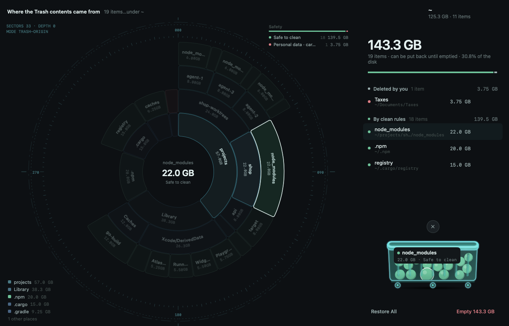

### Styles and languages

- **Ten styles:** HUD, Mech, Classic, Blueprint, Terminal, Industrial, E-ink, Happy, Pinky and Greeny. Each has its own way of painting sectors, its own instrument layer and its own effects, such as the terminal's CRT power-on with a typed command line, and the blueprint's linework drawn before its washes.
- **The Dock icon follows the style.** While Tossy runs, its Dock icon is the bin drawn the way the current style draws it, on that style's ground.
- **Reduce motion** option.
- **Languages:** English, Simplified Chinese, Traditional Chinese and Japanese. Follows the system language by default.

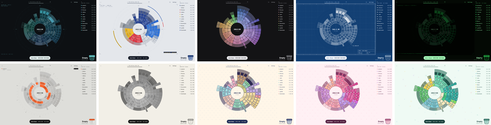

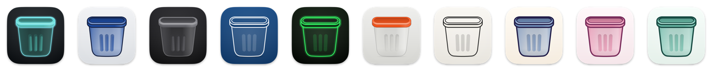

### Settings

Settings are grouped into Appearance, Scan (default location, excluded paths, crossing volumes), Cleaning (review sheet, analysis sweep, in-use protection), Clean habits, Trash and Updates (the version, a check on demand, and the background checks). They are saved to `settings.json` in the state folder; the choices about updates are the updater's, in `updater.json` beside it.

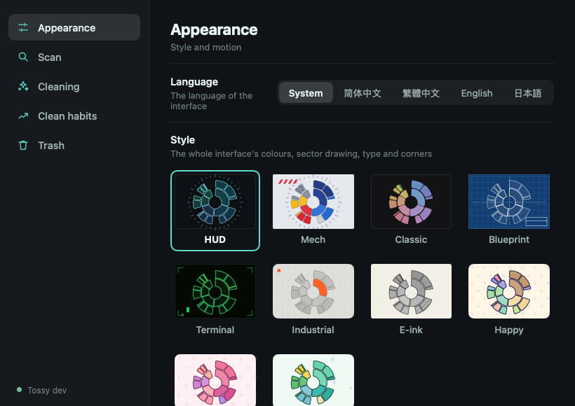

### Keyboard shortcuts

| Key | Action |
| --- | --- |
| ↑ / ↓ | Move through the list |
| Enter | Open the selected folder |
| Backspace | Go up one level |
| Delete, ⌘⌫ | Move the selection to the trash |
| Esc | Leave the analysis / the trash view / the detail, or go up |
| ⌘D (Ctrl+D) | Switch between the disk view and the developer view |
| ⌘, (Ctrl+,) | Open Settings |

## Command line

```
tossy scan  [-w workers] [-x] [-top n] [path]   scan and print the largest entries
tossy eval  [-review] [-top n] [path]           scan, then list what is safe to clean (read-only)
tossy dev   [-top n] [path]                     scan, then list developer content by kind (read-only)
tossy clean [-review] [-yes] [path]             move safe items (and learned habits) to the trash; dry run without -yes
tossy rm path...                                move to the trash by hand (Tossy learns from this)
tossy trash [list | restore id... | empty [id...]]
tossy habit [list | forget key]
```

`path` defaults to the current directory. `-review` also includes review-level items. `tossy dev` does not read personal folders (Documents, Pictures, a `.git`) or trash folders at all, since nothing in them is developer content.

## Build and run

Requires Go 1.27 or later.

```bash
go build -o bin/tossy ./cmd/tossy
```

```bash
go run github.com/egoist/mygo/cmd/mygo dev ./app
```

```bash
go run github.com/egoist/mygo/cmd/mygo build ./app
```

```bash
go test ./...
```

`mygo dev` runs a development build with live reload. `mygo build` builds the release app into `app/build/<os>-<arch>/`; see [app/mygo.json](app/mygo.json). MyGo needs no cgo, so any machine builds for both platforms, though only macOS makes the `.dmg`:

```bash
cd app && go run github.com/egoist/mygo/cmd/mygo build -platform darwin/universal,linux/amd64,linux/arm64 .
```

On macOS that gives a universal `Tossy.app` and `tossy-<version>.dmg`; for Linux, the executable, a desktop entry, a `.deb`, an `.rpm`, a `.tar.gz` with `install.sh`, and a `PKGBUILD` for Arch.

The screenshots and the Dock icon strip in this README are rendered headlessly by tests, in English, from a synthetic home folder:

```bash
cd app && TOSSY_README_SHOTS=$PWD/../docs/screenshots go test -run TestReadmeShots .
```

```bash
cd app && TOSSY_ICONS=$PWD/../docs go test -run TestDockIcons .
```

## Releasing

[.github/workflows/release.yml](.github/workflows/release.yml) builds the macOS app on macOS, signed with the Developer ID and notarized by Apple, the Linux packages (x86-64 and ARM64) on Ubuntu, the Windows installers (x64 and ARM64) on Windows and the command-line tool for every platform, and attaches them to a draft release. To release, set `version` in [app/mygo.json](app/mygo.json), commit, and push the matching tag:

```bash
git tag v0.1.0
```

```bash
git push origin v0.1.0
```

The workflow checks that the tag matches the version, then creates the draft release `v0.1.0` with generated notes and `SHA256SUMS`. It signs the macOS app with `macos.signingIdentity` of [app/mygo.json](app/mygo.json), has Apple notarize the disk image under the profile that `macos.notarize` names, and staples the ticket. The Developer ID and the notary credentials are secrets of the repository, set once: export the "Developer ID Application" certificate with its private key from Keychain Access as a `.p12` with a password, create an app-specific password for the Apple ID at [account.apple.com](https://account.apple.com) (Sign-In and Security), then:

```bash
base64 -i certificate.p12 | gh secret set MACOS_CERTIFICATE --repo 21stware/tossy
```

```bash
gh secret set MACOS_CERTIFICATE_PASSWORD --repo 21stware/tossy
```

```bash
gh secret set APPLE_ID --repo 21stware/tossy
```

```bash
gh secret set APPLE_TEAM_ID --repo 21stware/tossy --body R54TY86R4C
```

```bash
gh secret set APPLE_APP_PASSWORD --repo 21stware/tossy
```

A tag without them fails before building. To build and notarize the macOS app on a Mac instead, store the notary profile once with `xcrun notarytool store-credentials tossy-notary`, and from `app`:

```bash
MYGO_UPDATER_PRIVATE_KEY="$(cat "$HOME/Library/Application Support/mygo/update-keys/mygo-update.key")" go tool mygo build -platform darwin/universal -upload .
```

Review the draft and publish it on GitHub: once it is the latest release, installed apps update to it. Running the workflow by hand (Actions → Release → Run workflow) builds everything as run artifacts without a release, the macOS app signed ad hoc. [.github/workflows/ci.yml](.github/workflows/ci.yml) vets and tests every push and pull request on Linux and macOS.

Updates are MyGo's [auto-updates](https://github.com/egoist/mygo/blob/main/docs/updates.md), configured under `updates` in [app/mygo.json](app/mygo.json). With the key that signs them in the `MYGO_UPDATER_PRIVATE_KEY` secret, the build adds to each platform an update archive (the Linux `tar.gz`, `tossy-<version>-darwin-universal.tar.gz`), its manifest `update-<platform>.json`, which installed apps read from the latest release, and `.delta` files from the last three versions. A tag without the secret fails before building, as no installed app could update to its release. The secret is the contents of `mygo-update.key`, which `go tool mygo keygen` writes; its public half is `updates.publicKey`. Keep the key safe: apps accept only updates signed with it, so losing it strands the installed ones.

```bash
gh secret set MYGO_UPDATER_PRIVATE_KEY --repo 21stware/tossy < "$HOME/Library/Application Support/mygo/update-keys/mygo-update.key"
```

The update window shows the version's section of a `CHANGELOG.md` in `app/` (`## 0.2.0`) as its release notes; when the file exists, it must have that section.

## Website

[tossy.app](https://tossy.app) is the static page in [site/](site/). [.github/workflows/pages.yml](.github/workflows/pages.yml) publishes it to GitHub Pages on every push to `main` that touches it. To preview it:

```bash
python3 -m http.server --directory site 4173
```

Its pictures are the README's screenshots as WebP, plus the overview in every style, which `TestReadmeShots` also writes when `TOSSY_STYLE_SHOTS` names a folder. The page's style switcher shows them, and takes its colours from the palettes in [app/theme.go](app/theme.go):

```bash
cd app && TOSSY_README_SHOTS=$PWD/../docs/screenshots TOSSY_STYLE_SHOTS=$PWD/build/styles go test -run TestReadmeShots .
```

```bash
for f in app/build/styles/*.png docs/screenshots/{analysis,browse,developer,git,trash}.png; do cwebp -quiet -q 90 -m 6 -sharp_yuv "$f" -o "site/shots/$(basename "${f%.png}").webp"; done
```

## Rendering

The chart is drawn so that MyGo never needs a coverage mask for it, which keeps every frame on the GPU:

- **Sectors** (fill, glow and outline) are drawn by one instanced shader that computes the signed distance to a rounded annular sector, in [app/sectors.go](app/sectors.go). The radar trail, the analysis wake and its pulse ring use the same shader. Without a GPU, the same shapes are drawn as paths.
- **Lines and decorations** (ticks, dashed rings, grids, frames, scanlines) are drawn as opaque polylines or single segments, which also need no mask. Shapes that still need a path, such as dots or brackets, are drawn one small path at a time; see [app/pieces.go](app/pieces.go).

MyGo v0.9.0 dropped paths when a frame's masks overflowed its atlas, which made the chart flicker ([egoist/mygo#1841](https://github.com/egoist/mygo/issues/1841)). v0.9.1 draws the overflow on the CPU instead, and Tossy requires it, but the chart no longer depends on that fallback. `go test ./app` checks the shader against the path renderer pixel for pixel.

## Where data lives

Tossy keeps its state (the trash journal, `habits.json` and `settings.json`) in a `Tossy` folder in the user config directory:

- macOS: `~/Library/Application Support/Tossy`
- Linux: `~/.config/Tossy`
- Windows: `%AppData%\Tossy`

Tossy used to be called FanFree. On first run, an existing `FanFree` folder is renamed to `Tossy`, so the trash, habits and settings carry over.

Environment variables: `TOSSY_STATE` puts the state somewhere else, `TOSSY_THEME` picks a style (for example `TOSSY_THEME=blueprint`), and `TOSSY_LANG` picks a language (`en`, `zh-Hans`, `zh-Hant`, `ja`).

## Layout

```
cmd/tossy        command-line tool
app/             MyGo desktop app
engine/scan      parallel scanner and compact tree
engine/safety    safety rules and verdicts
engine/trash     trash journal, restore and empty
engine/habit     learning clean habits from manual deletions
engine/gitrepo   Git repository and worktree status
engine/statedir  state folder location and FanFree migration
prototype/       interactive HTML prototype
docs/            README screenshots, the Dock icon strip, the icon's SVG sources
site/            the website, tossy.app
.github/         CI, release and website workflows
```
