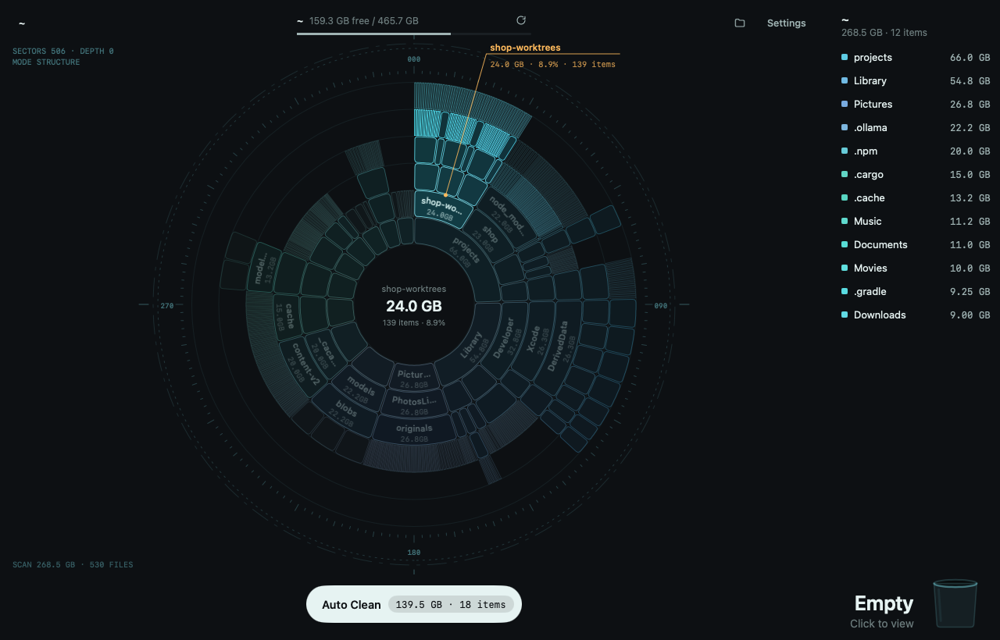
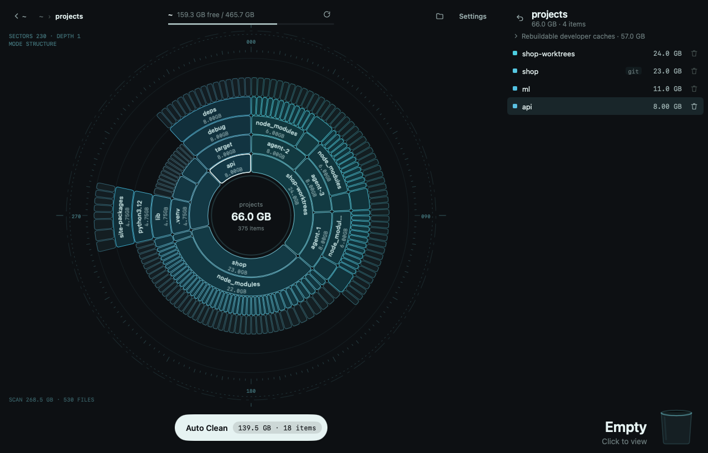
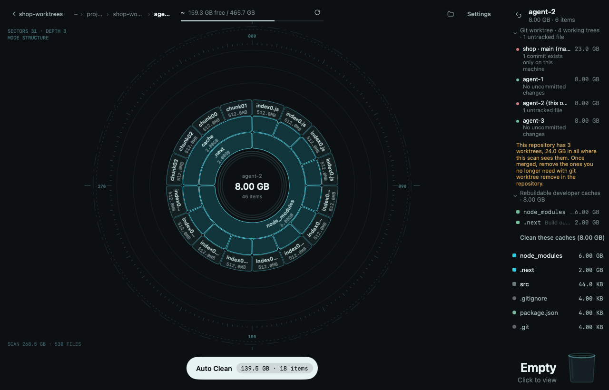
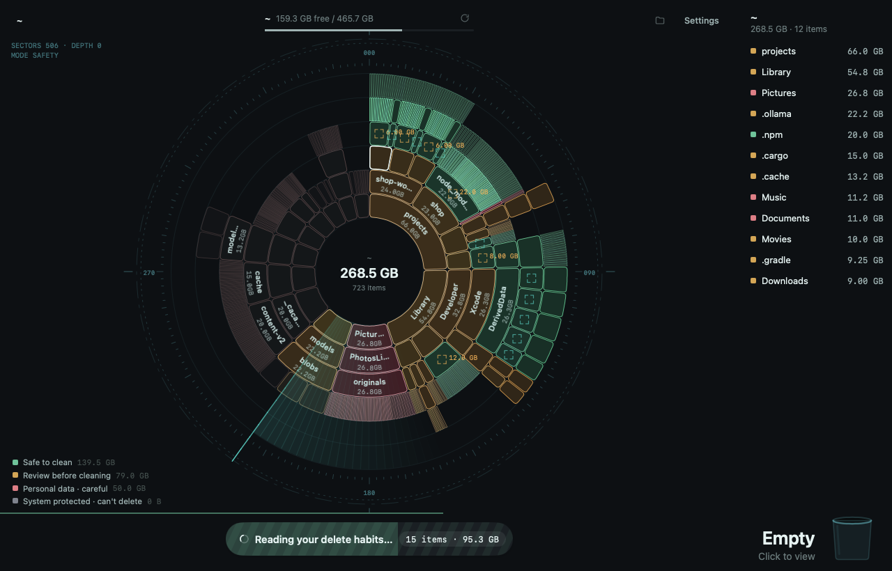
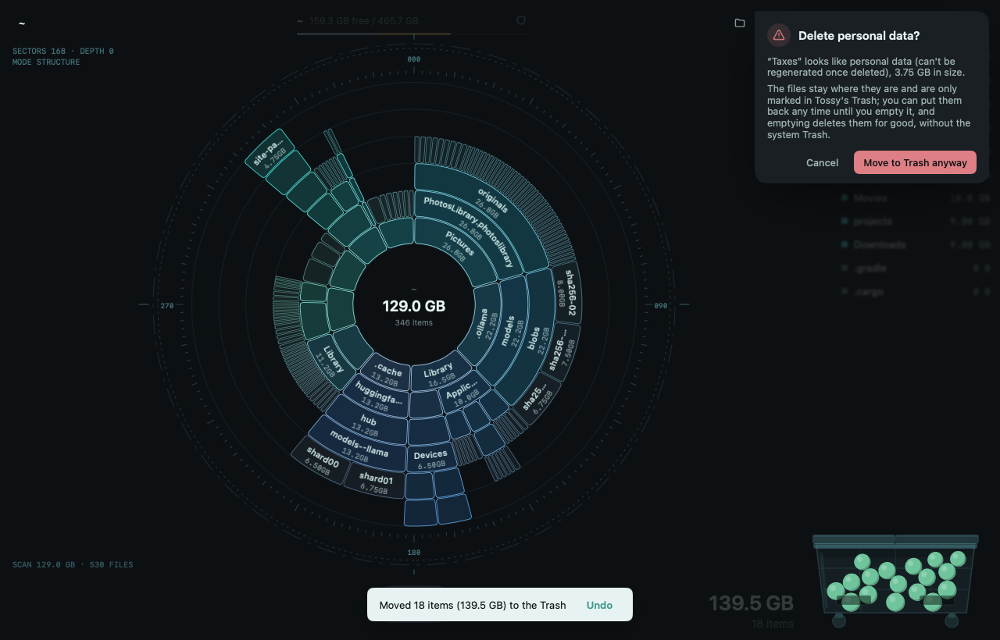
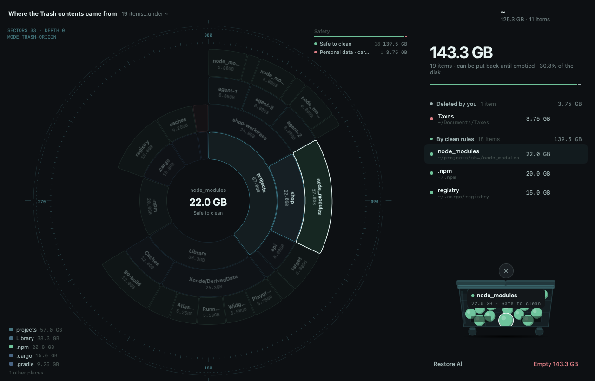
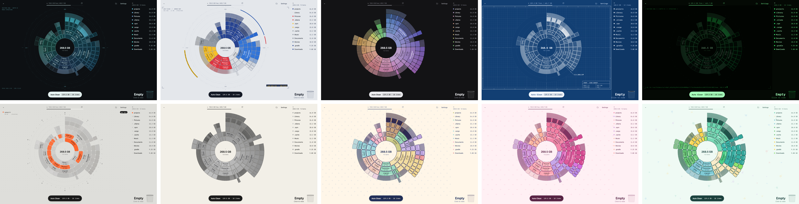
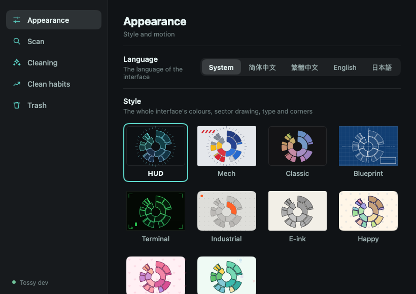

# Tossy

Tossy is a disk cleanup analyser. It shows what fills your disk as a sunburst you can drill into, gives everything a safety verdict, and cleans only what is safe to clean in one click. Anything it removes can be put back until you empty its trash.

It ships as a native desktop app (built with [MyGo](https://github.com/egoist/mygo)) and a command-line tool, both on the same Go engine. It runs on macOS, Linux and Windows.



## Features

### See what fills the disk

- **Fast parallel scan** that builds a compact tree able to hold millions of entries. On macOS it reads whole batches of directory entries per syscall (`getattrlistbulk`), on Linux it uses `fstatat`, and on Windows it takes sizes straight from `FindFirstFile`. Pseudo filesystems are skipped, and other volumes are left alone unless you allow it.
- **Sunburst chart.** Click a sector to drill in; use the centre, the breadcrumbs or Backspace to go back up. Sectors morph when things are removed or restored. While scanning, the chart is a radar sweep with live counters.
- **List and detail.** The right-hand panel lists the folder in focus by size; selecting a file slides in its detail with the verdict and the reason for it.
- **Disk line** at the top shows how full the volume is.



### Safety verdicts

About 90 built-in rules give every item one of four levels. An item without a rule of its own inherits its parent's verdict.

| Level | Meaning | Examples |
| --- | --- | --- |
| Safe | Rebuilt or re-downloaded on demand | App caches, `node_modules`, `__pycache__`, npm / pnpm / Cargo / Go / Maven / Gradle caches, Xcode DerivedData, Rust `target`, Homebrew cache |
| Review | Probably fine, but you should confirm | Docker and VM disks, iOS simulators, local models (Ollama, LM Studio, Hugging Face), Python virtualenvs, build output, Downloads, AI coding-assistant sessions |
| Personal | Your own data | Documents, Desktop, Photos, Mail, `.ssh`, `.gnupg`, `.git` |
| Protected | The OS needs it; Tossy never deletes it | `/System`, `/usr`, `C:\Windows`, `WinSxS` |

Generic names such as `dist`, `build`, `target` or `vendor` only match inside a real project, recognised by marker files like `package.json`, `Cargo.toml` or `go.mod`.

### Developer folders

- **Git checkouts are judged as a whole.** Before you delete a repository or worktree, Tossy asks git about uncommitted changes, untracked files and commits that exist only on this machine, and tells you what would be lost.
- **Worktrees at a glance.** A repository lists every worktree that shares its object store; AI coding agents tend to leave many behind.
- **Build caches per project.** A project folder lists the dependency and build caches inside it, with one button to clean them.



### Cleaning

- **Auto Clean** sweeps the whole scan using the rules and your learned habits, shows what it finds as it goes, and then throws the plan into the trash. It only takes things that are regenerated on demand, or that match something you have deleted by hand before.
- **In-use protection.** Items written in the last few minutes (10 by default) and the caches of apps that are running are skipped, so a clean never pulls caches out from under a running program.
- **Delete by hand** with the row's bin button, the context menu, the keyboard (Delete / ⌘⌫), or by dragging a sector onto the bin. Protected items shake and say why. Personal data asks first. Everything else goes at once, with an undo.
- **Learns your habits.** Each manual deletion is generalised to "parent folder + shape" (a sub-folder, a file extension, or "older than two months"). Once a shape has been seen often enough it becomes a habit, and Auto Clean takes the same kind of item next time and says why. Restoring an item a habit picked counts double against it. You can review, forget or turn off habits in Settings.





### The trash

- **A mark, not a move.** Putting something in Tossy's trash only records a mark in a journal. The file stays where it is, and the system trash is never touched. Restoring drops the mark; emptying deletes exactly the marked paths, in place, for good.
- **Trash view.** The bin grows with what is in it, from a desk basket to a skip. Items lie in it as balls coloured by safety level. Next to it, a chart rebuilds where the contents came from, and hovering a ball, a row or a sector lights up the other two. Items are grouped by why they were removed (Auto Clean, a habit, or by hand), with a safety breakdown.
- **Restore and empty.** Restore items one at a time or all at once. Before emptying, the bin asks in a speech bubble; then the balls vanish one by one and the freed space shows on the disk line.
- Items that older versions really moved into the system trash (macOS Trash, freedesktop.org Trash, Windows Recycle Bin) can still be restored or purged.



### Styles and languages

- **Ten styles:** HUD, Mech, Classic, Blueprint, Terminal, Industrial, E-ink, Happy, Pinky and Greeny. Each has its own way of painting sectors, its own instrument layer and its own effects, such as the e-ink refresh flash, the terminal's CRT power-on with a typed command line, and the blueprint's linework drawn before its washes.
- **Reduce motion** option.
- **Languages:** English, Simplified Chinese, Traditional Chinese and Japanese. Follows the system language by default.



### Settings

Settings are grouped into Appearance, Scan (default location, excluded paths, crossing volumes), Cleaning (review sheet, analysis sweep, in-use protection), Clean habits and Trash. They are saved to `settings.json` in the state folder.



### Keyboard shortcuts

| Key | Action |
| --- | --- |
| ↑ / ↓ | Move through the list |
| Enter | Open the selected folder |
| Backspace | Go up one level |
| Delete, ⌘⌫ | Move the selection to the trash |
| Esc | Leave the analysis / the trash view / the detail, or go up |
| ⌘, (Ctrl+,) | Open Settings |

## Command line

```
tossy scan  [-w workers] [-x] [-top n] [path]   scan and print the largest entries
tossy eval  [-review] [-top n] [path]           scan, then list what is safe to clean (read-only)
tossy clean [-review] [-yes] [path]             move safe items (and learned habits) to the trash; dry run without -yes
tossy rm path...                                move to the trash by hand (Tossy learns from this)
tossy trash [list | restore id... | empty [id...]]
tossy habit [list | forget key]
```

`path` defaults to the current directory. `-review` also includes review-level items.

## Build and run

Requires Go 1.27 or later.

```bash
go build -o bin/tossy ./cmd/tossy
```

```bash
go run github.com/egoist/mygo/cmd/mygo dev ./app
```

```bash
go run github.com/egoist/mygo/cmd/mygo build ./app
```

```bash
go test ./...
```

`mygo dev` runs a development build with live reload. `mygo build` builds the release app (a `.app` and a `.dmg` on macOS) into `app/build/`; see [app/mygo.json](app/mygo.json).

The screenshots in this README are rendered headlessly by a test, in English, from a synthetic home folder:

```bash
cd app && TOSSY_README_SHOTS=$PWD/../docs/screenshots go test -run TestReadmeShots .
```

## Where data lives

Tossy keeps its state (the trash journal, `habits.json` and `settings.json`) in a `Tossy` folder in the user config directory:

- macOS: `~/Library/Application Support/Tossy`
- Linux: `~/.config/Tossy`
- Windows: `%AppData%\Tossy`

Tossy used to be called FanFree. On first run, an existing `FanFree` folder is renamed to `Tossy`, so the trash, habits and settings carry over.

Environment variables: `TOSSY_STATE` puts the state somewhere else, `TOSSY_THEME` picks a style (for example `TOSSY_THEME=blueprint`), and `TOSSY_LANG` picks a language (`en`, `zh-Hans`, `zh-Hant`, `ja`).

## Layout

```
cmd/tossy        command-line tool
app/             MyGo desktop app
engine/scan      parallel scanner and compact tree
engine/safety    safety rules and verdicts
engine/trash     trash journal, restore and empty
engine/habit     learning clean habits from manual deletions
engine/gitrepo   Git repository and worktree status
engine/statedir  state folder location and FanFree migration
prototype/       interactive HTML prototype
docs/            README screenshots
```
